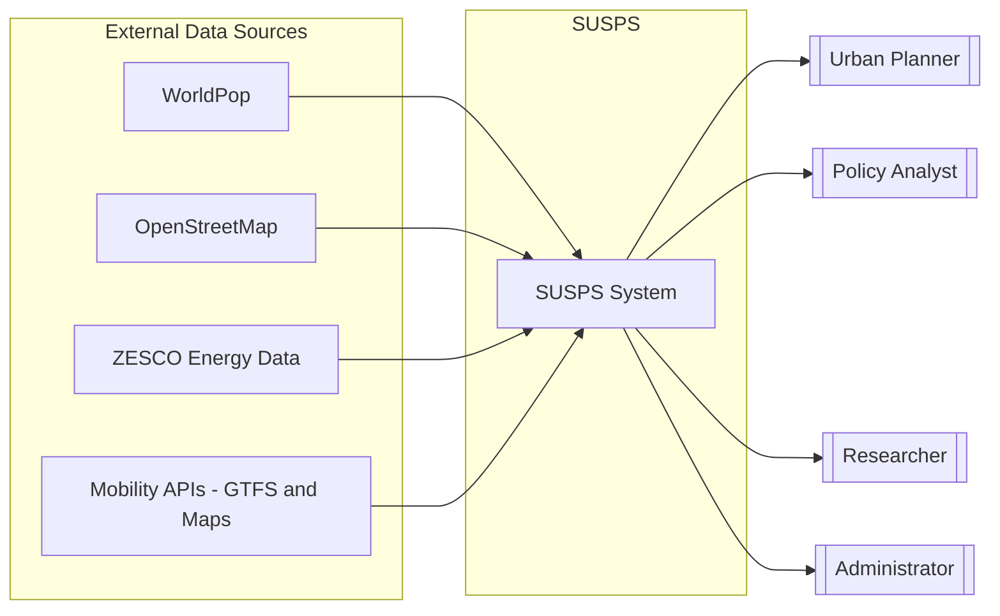
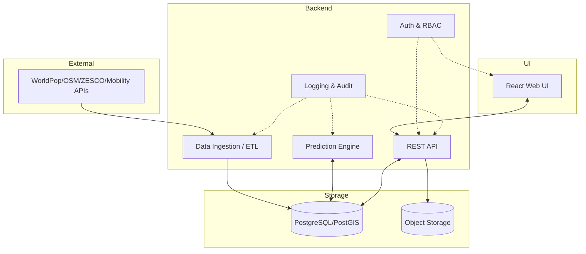
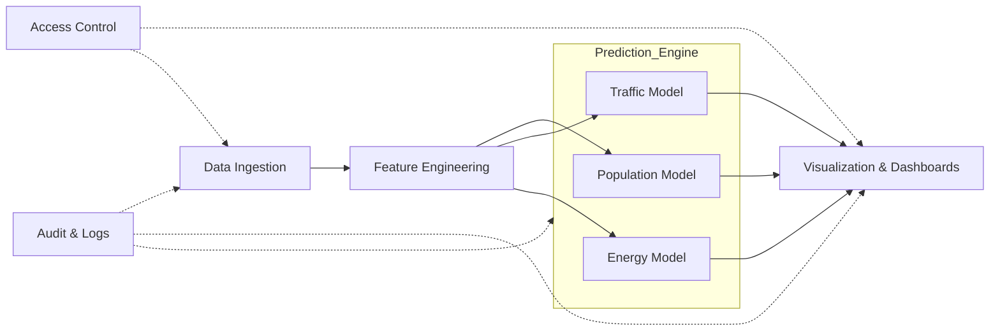
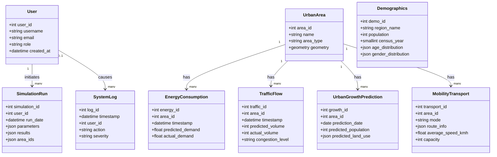
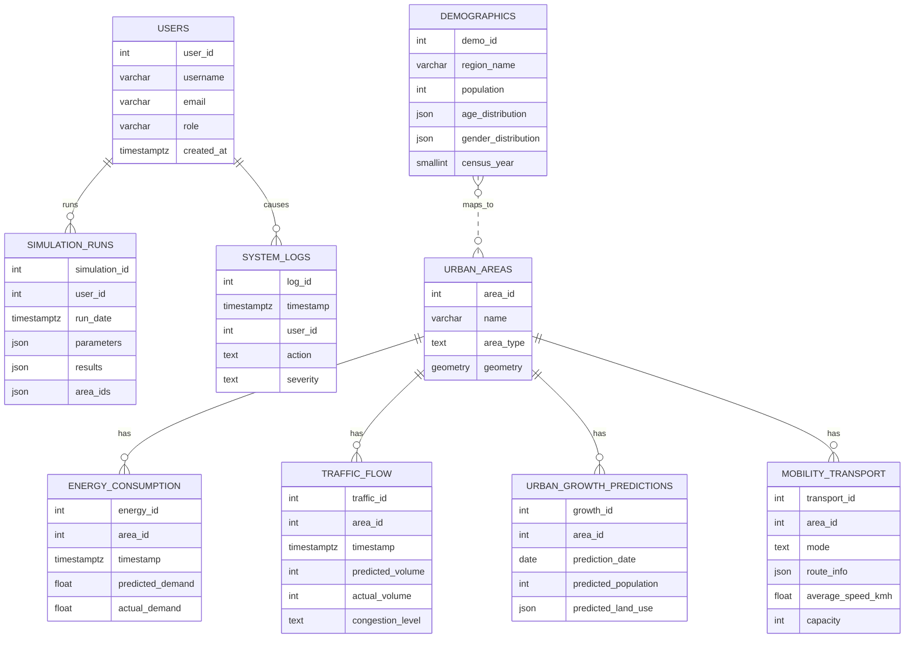
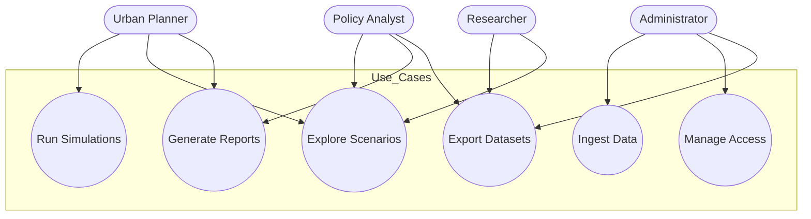
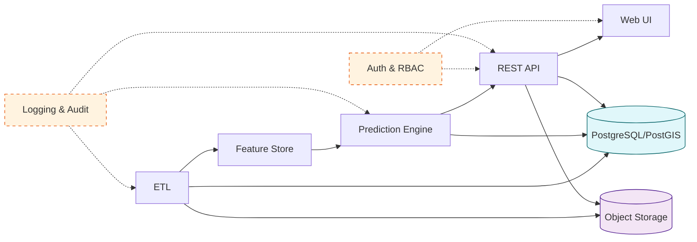
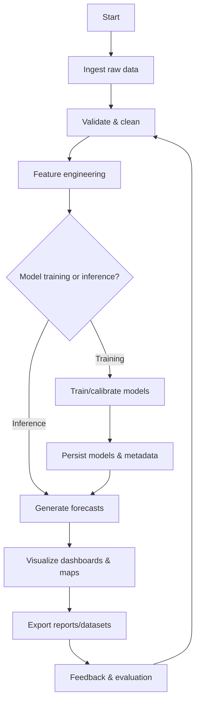
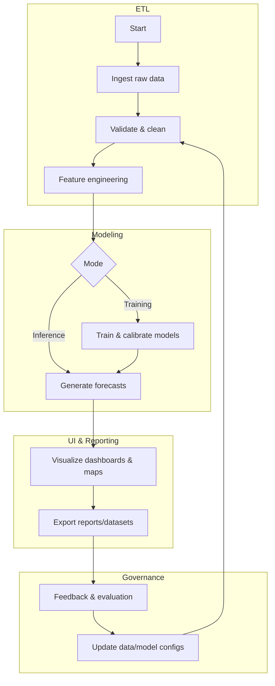
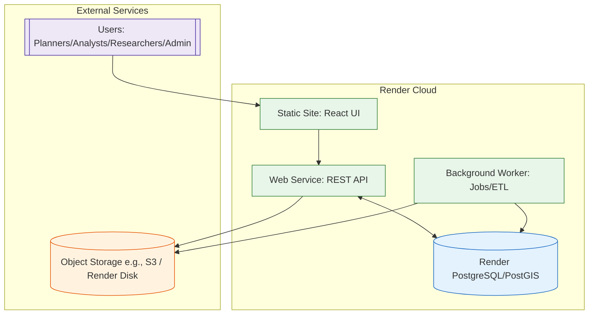

# CHAPTER ONE: INTRODUCTION

## 1.0 Introduction

Urbanization is one of the most pressing challenges facing developing nations today. Globally, more than 55% of the world’s population lives in urban areas, a figure projected to rise to 68% by 2050 (United Nations, 2019). Rapid and unplanned urban growth has created immense pressure on infrastructure, transportation, housing, and energy systems, particularly in Sub-Saharan Africa where urbanization often outpaces economic growth and institutional capacity (World Bank, 2021).

In Zambia, cities such as Lusaka and emerging towns are experiencing similar pressures, with population increases straining existing infrastructure, utilities, and transport systems. Traditional planning methods that rely on periodic censuses or manual projections are often inadequate to keep up with the pace of change. Furthermore, the lack of integrated, data-driven tools makes it difficult for urban planners, policymakers, and researchers to make informed decisions.  

The **Smart Urban Simulation and Prediction System (SUSPS)** seeks to address these challenges by integrating demographic, mobility, and environmental datasets into a predictive model capable of simulating urban growth, forecasting energy demand, and projecting traffic flow patterns. By leveraging artificial intelligence, geospatial data, and simulation techniques, the project aims to provide decision-makers with actionable insights for sustainable urban planning in Zambia.

## 1.1 Background

Urban planning has historically been reactive rather than proactive, with many African cities facing traffic congestion, inadequate housing, and inefficient energy distribution due to poor foresight (UN-Habitat, 2020). Globally, cities are adopting smart systems that rely on real-time and historical datasets to model and predict urban dynamics, enabling more sustainable growth strategies (Batty, 2018).

In Zambia, while initiatives exist in housing and energy planning, there remains a significant gap in tools that integrate diverse datasets—such as census records, transportation networks, and satellite imagery—into a single predictive framework. This absence has contributed to issues such as unmanaged informal settlements, frequent power shortages, and worsening traffic congestion in urban centers. The SUSPS project addresses this gap by proposing a unified platform for urban simulation and prediction.

## 1.2 Motivation of the Study

The primary motivation for this study is the urgent need to develop sustainable cities in Zambia. The lack of robust planning tools has contributed to rising traffic congestion, poor energy distribution, and inefficient land use. By leveraging advanced data-driven simulation, SUSPS aims to provide urban planners with the capacity to anticipate future challenges and design policies that address them before they escalate. Additionally, the study aligns with Zambia’s Vision 2030 and the UN Sustainable Development Goals (SDGs), particularly Goal 11 on Sustainable Cities and Communities.

## 1.3 Significance of the Study

This study is significant for several reasons:

- **Policy Support:** It will provide evidence-based insights for government agencies and city planners to make informed decisions on infrastructure development.  
- **Sustainability:** By predicting urban growth and energy needs, the system will help optimize resource allocation, ensuring more sustainable urbanization.  
- **Academic Contribution:** The study contributes to the field of smart city research in Sub-Saharan Africa, where empirical tools are still limited.  
- **Practical Benefits:** Communities will benefit from improved transportation efficiency, reliable energy distribution, and reduced congestion.

## 1.4 Scope of the Study

The project focuses on integrating demographic, mobility, and environmental datasets to simulate and predict urban growth, with Lusaka as the target deployment context. For the demonstration phase of this proposal, Nairobi will be used due to current data limitations in Zambia; the methods and pipelines are designed for direct portability to Lusaka. The scope includes:

- Predicting urban population growth patterns.
- Forecasting energy demand based on projected population growth and land use.
- Simulating traffic flow and transport demand.
The study does not extend to national-level energy policy formulation or detailed economic modelling but instead focuses on urban-scale simulations.

## 1.5 Problem Statement

Unplanned urban growth in Zambia has led to severe challenges, including traffic congestion, unreliable energy supply, and unsustainable land use. Existing planning methods are often reactive, fragmented, and based on outdated data sources. This gap results in inefficient infrastructure investment and an inability to anticipate urban challenges. The problem is the absence of an integrated, AI-driven urban simulation system that can provide policymakers with predictive insights for sustainable planning.

## 1.6 Objectives

### 1.6.1 General Objective

To develop a Smart Urban Simulation and Prediction System (SUSPS) that integrates demographic, mobility, and environmental data to predict urban growth, energy needs, and traffic flow in Lusaka, Zambia. Demonstration for this phase will be conducted on Nairobi data due to current data limitations in Zambia, with the system intended for deployment in Lusaka.

### 1.6.2 Specific Objectives

1. To analyze demographic and population growth trends using census and geospatial data.  
2. To forecast future energy demands based on population and land-use projections.  
3. To model urban traffic flow using transportation datasets and mobility APIs.  
4. To design and develop a prototype urban simulation system capable of producing predictive insights for planners.  
5. To evaluate the system’s effectiveness in addressing urban growth challenges in Lusaka.

## 1.7 Research Questions

1. How can demographic and census data be integrated into urban growth prediction models?  
2. What are the expected energy needs of Lusaka given current and projected urban growth patterns?  
3. How can mobility and transportation data be used to predict traffic flow and congestion hotspots?  
4. What design and system architecture are best suited for implementing an AI-driven urban simulation platform?  
5. How effective is the proposed SUSPS prototype in addressing existing urban planning challenges in Lusaka?

## 1.8 Conceptual/Theoretical Framework

The study draws on the **systems theory** and the **smart city conceptual framework**. Systems theory emphasizes the interdependence of subsystems (population, transport, energy, and environment), highlighting the need for integrated approaches to complex urban challenges (Skyttner, 2005). The smart city framework underscores the role of ICT and data analytics in creating sustainable and resilient urban systems (Albino et al., 2015). SUSPS conceptualizes the city as an interconnected system where changes in one component (e.g., population growth) directly affect others (e.g., energy demand, traffic flow).

## 1.9 Definition of Terms

- **Smart City:** An urban area that uses digital technologies to enhance performance, well-being, and sustainability.  
- **Simulation:** The imitation of real-world processes or systems over time using computational models.  
- **Prediction:** The use of statistical or AI models to estimate future conditions based on current and historical data.  
- **Geospatial Data:** Data that includes a geographic component, such as coordinates, maps, or satellite imagery.  
- **Mobility Data:** Information on the movement of people or vehicles, often collected through GPS, mobile networks, or transport APIs.  

## 1.10 Organization of the Report

This project proposal is organized as follows:

- **Chapter One:** Introduces the study, providing background, problem statement, objectives, research questions, and the conceptual framework.  
- **Chapter Two:** Reviews existing literature on urban simulation, smart cities, and related works, while identifying gaps in current research.  
- **Chapter Three:** Outlines the research design, methodology, and system design, including diagrams for technical architecture.  
- **References:** Presents all cited works, formatted according to the Harvard style.

---

# CHAPTER TWO: LITERATURE REVIEW

## 2.0 Overview

A literature review provides a critical assessment of existing research and knowledge relevant to a study. For this project, the review explores global and local perspectives on smart cities, urban simulation, traffic flow modeling, and energy demand forecasting. The goal is to demonstrate what is already known, highlight methodologies applied in similar studies, and identify knowledge gaps that the **Smart Urban Simulation and Prediction System (SUSPS)** aims to address.

## 2.1 Literature Review

### 2.1.1 Smart Cities and Urban Growth

Globally, smart city initiatives leverage information and communication technologies (ICT), data analytics, and artificial intelligence (AI) to improve urban sustainability and livability (Albino et al., 2015). Smart urban planning approaches have enabled cities such as Singapore, Barcelona, and Amsterdam to use predictive analytics in transport and energy planning (Batty, 2018).  

In Sub-Saharan Africa, however, smart city projects are still limited in scale and implementation. While some countries have piloted digital transport management systems and renewable energy integration, the absence of comprehensive predictive frameworks has hindered sustainable growth (UN-Habitat, 2020). Zambia has begun adopting digital solutions in infrastructure planning, but most initiatives remain fragmented, with little integration of demographic, transport, and energy data. This highlights the need for systems such as SUSPS that can unify diverse datasets. Additionally, scholarship cautions against techno-solutionism and highlights governance, ethics, and local context as critical success factors for smart-city programs (Hollands, 2008; Kitchin, 2014; Townsend, 2013).

### 2.1.2 Urban Simulation and Modeling

Urban simulation models have been widely applied to predict population growth, land use, and infrastructure demand. Agent-based models and cellular automata are commonly used for simulating complex interactions within cities (Wegener, 2011). In Europe and Asia, urban simulation has been instrumental in anticipating settlement expansion and informing land-use policies.  

African cities, however, often lack the data and computational infrastructure required for effective modeling (Lemmens et al., 2017). This creates challenges in adapting global methodologies to local contexts. The SUSPS framework addresses this limitation by integrating open-source geospatial data (e.g., WorldPop), census records, and transport datasets into predictive simulations tailored to Lusaka’s urban dynamics. Beyond local adaptation, established urban-modeling paradigms such as UrbanSim and SLEUTH demonstrate integrated land use–transport pipelines and CA/ABM approaches suitable for spatially explicit growth (Waddell, 2002; Silva & Clarke, 2002; Batty, 2013).

### 2.1.3 Traffic Flow Prediction

Traffic congestion is one of the most common urban challenges, leading to economic losses, environmental pollution, and reduced quality of life (Litman, 2021). Predictive traffic models use GPS data, mobile phone records, and General Transit Feed Specification (GTFS) data to simulate traffic flow and identify congestion hotspots. Google Maps and Digital Matatus in Nairobi are examples of platforms where GTFS has been successfully applied to enhance mobility planning (Williams et al., 2015).  

In Lusaka, traffic management remains largely reactive, with limited use of predictive analytics. Introducing AI-driven simulations could help predict congestion trends and guide infrastructural interventions. The SUSPS project will use mobility datasets and transport APIs to model and predict future traffic conditions. Recent surveys and methods show that statistical, machine learning, and deep-learning approaches (e.g., LSTM and graph-based models) can substantially improve short-term traffic forecasts (Vlahogianni et al., 2014; Lv et al., 2015; Zheng et al., 2014).

### 2.1.4 Energy Demand Forecasting

Energy demand in urban areas is directly influenced by population growth, industrialization, and housing development (International Energy Agency, 2019). Advanced energy forecasting models often rely on time-series data, weather conditions, and demographic patterns to estimate demand. Studies show that predictive models can optimize grid management and reduce power outages (Ghosh et al., 2018).  

In Zambia, frequent power shortages highlight the urgent need for predictive energy demand modeling. Current planning methods are reactive, relying on manual forecasting and limited datasets. By combining demographic projections with land-use and housing data, SUSPS can provide insights into future energy needs, enabling more resilient energy planning. Best-practice demand modeling combines decomposition and time-series forecasting with exogenous covariates and evaluates accuracy with scale-independent error metrics (Hyndman & Athanasopoulos, 2018; Deb et al., 2017).

## 2.2 Related Works

Several projects provide a foundation for the SUSPS approach:

- **Digital Matatus Project (Kenya):** Digitized informal public transport systems in Nairobi using GTFS data, improving route planning and transport research (Williams et al., 2015).  
- **UrbanSim (USA):** A widely used simulation platform for modeling land use, transportation, and environmental impacts of urban development (Waddell, 2002).  
- **Energy Forecasting Models:** Studies integrating AI and machine learning for household energy demand prediction have proven effective in optimizing consumption patterns (Ghosh et al., 2018).  

While these works demonstrate the value of simulation and predictive analytics, they are often designed for contexts with strong data infrastructures, limiting their direct applicability to Zambian cities. SUSPS adapts these models to the local context by leveraging available open datasets and designing scalable, lightweight simulations.

## 2.3 Gaps in the Literature

Despite global progress in urban simulation and smart city development, three major gaps remain in the Zambian context:

1. **Lack of Integrated Platforms:** Existing initiatives address transport, energy, or population separately, with no unified simulation system.  
2. **Data Challenges:** There is limited use of open-source demographic, transport, and geospatial data in predictive modeling for Lusaka.  
3. **Local Adaptation:** Global smart city models are not sufficiently tailored to African urban contexts, where informal settlements, limited infrastructure, and unique growth patterns require customized approaches.  

The SUSPS project addresses these gaps by creating a localized, integrated simulation framework that can forecast urban growth, traffic, and energy needs specifically for Lusaka, Zambia.

---

# CHAPTER THREE: RESEARCH DESIGN AND SYSTEM DESIGN

## 3.0 Overview

This chapter outlines the methodological framework adopted for the development of the **Smart Urban Simulation and Prediction System (SUSPS)**. It details the research design, baseline study, data collection methods, research approach, and the system development process. Furthermore, it presents the system design, including diagrams to illustrate the architecture, data models, and interactions. The chapter also discusses challenges anticipated during the project and the strategies proposed to address them.

## 3.1 Research Design

The research adopts a **design science approach**, focusing on the development of an innovative solution to address urban planning challenges in Lusaka. This design combines:

- **Quantitative analysis** of demographic, transport, and energy datasets.  
- **Simulation modeling** to predict urban growth, traffic flow, and energy demand.  
- **System prototyping** to design and test the SUSPS platform.  

This mixed-method approach ensures that the study is both empirical (data-driven) and practical (application-oriented). It aligns with best practices in software engineering research (Pressman, 2010; Sommerville, 2011).

## 3.2 Baseline Study

### 3.2.1 Data Collection

The system integrates multiple datasets, sourced from both open platforms and local institutions:

- **Demographics & Population:** WorldPop datasets, Zambia census records.  
- **Mobility & Transport:** GTFS data from Digital Matatus (as a reference model), OpenStreetMap extracts, and local traffic datasets.  
- **Energy:** Historical consumption data from Zambia Electricity Supply Corporation (ZESCO), population–energy correlation studies, and international datasets.  

Data collection tools will include:  

- **APIs:** For mobility and geospatial data (e.g., Google Maps API, OSM extracts).  
- **CSV/GeoTIFF imports:** For demographic and census datasets.  
- **ETL pipelines:** To clean, transform, and integrate datasets into a central database.

Note on demonstration city: For this phase, Nairobi will be used as the demonstration environment because of greater data availability and similarity to Lusaka’s urban structure; all ETL and model configurations will be parameterized to allow later switching to Lusaka datasets.

### 3.2.2 Research Approach

The study will follow an **iterative approach** inspired by the agile methodology. The system will be developed in cycles, allowing incremental integration of datasets, validation of models, and refinement of predictions.  

**Key phases:**  

1. **Requirement Analysis** – Identify functional and non-functional requirements.  
2. **Prototype Development** – Create a minimum viable system for testing.  
3. **Simulation Integration** – Add AI-driven models for prediction.  
4. **Evaluation** – Test system accuracy, reliability, and scalability.  

### 3.2.3 Development of the Application

The SUSPS prototype will be developed as a **web-based application** using modern frameworks.  

- **Backend:** Python (Django/Flask) for data processing and model integration.  
- **Frontend:** React for visualization and interactive dashboards.  
- **Database:** PostgreSQL (SQL) with PostGIS; schema as defined in 3.3.6 (Users, Demographics, Urban Areas, Mobility & Transport, Energy Consumption, Traffic Flow, Urban Growth Predictions, Simulation Runs, System Logs). SQL is used for DDL/DML/analytics; spatial data on urban_areas.geometry; JSON fields for route_info/parameters/results; appropriate GIST/BTREE/GIN indexes.  
- **APIs:** RESTful APIs for integration with third-party services and datasets.  

Deployment will be cloud-based (e.g., Render, AWS, or Azure) for scalability and accessibility.

### 3.2.4 System Design

The system will incorporate the following modules:  

- **Data Ingestion Module:** Imports, cleans, and integrates demographic, transport, and energy datasets.  
- **Prediction Engine:** Runs simulation models for population, traffic, and energy demand.  
- **Visualization Module:** Provides dashboards, maps, and charts for planners.  
- **User Interface:** Interactive web-based system for policymakers and stakeholders.  

### 3.2.5 Users and Use Cases

Primary users and typical use-cases:
- Urban planners: scenario-based growth projections; congestion hotspot maps; energy demand curves by ward/district.
- Policy analysts: compare infrastructure investment options across scenarios; evaluate SDG-aligned indicators and equity outcomes.
- Researchers and analysts: export datasets, model outputs, and reproducible notebooks for secondary analysis.
- System administrators: manage data refreshes, model runs, and access control.

## 3.3 System Design

### 3.3.1 Context Diagram

The context diagram shows how SUSPS interacts with external data sources and users.  

### 3.3.2 System Software Level Architectural Design

The high-level architecture illustrates the system components, data flows, and external interfaces.  

### 3.3.3 Modular Design of the System Functions

Each functional module (data ingestion, prediction, visualization, interface) operates independently but communicates through defined APIs.  

### 3.3.4 System Class Diagram

The class diagram outlines entities such as *PopulationData, EnergyData, TransportData, SimulationModel,* and their relationships.  

### 3.3.5 System Data Model Design

The data model represents how datasets are structured and linked in the database, ensuring efficient querying and spatial analysis.  

### 3.3.6 Database Schema

This subsection specifies the relational schema implemented in SUSPS. Core tables are: Users, Demographics, Urban Areas, Mobility & Transport, Energy Consumption, Traffic Flow, Urban Growth Predictions, Simulation Runs, and System Logs. Spatial data are stored on Urban Areas.geometry (PostGIS), time-series measures use timestamp columns, and JSON fields capture flexible attributes (e.g., route_info, parameters, results). Primary/foreign keys and controlled values (roles, area_type, mode, congestion_level) enforce integrity. The schema is defined with SQL DDL and optimized with appropriate GIST/BTREE/GIN indexes and views/materialized views for common analytical queries.

### 1. Users

Stores information about users interacting with the system.

| Column Name    | Data Type                        | Constraints                | Description                |
| -------------- | -------------------------------- | -------------------------- | -------------------------- |
| user\_id       | INT                              | PK, AUTO\_INCREMENT        | Unique user identifier     |
| username       | VARCHAR(50)                      | NOT NULL, UNIQUE           | Username                   |
| email          | VARCHAR(100)                     | NOT NULL, UNIQUE           | User email                 |
| password\_hash | VARCHAR(255)                     | NOT NULL                   | Hashed password            |
| created\_at    | TIMESTAMP                        | DEFAULT CURRENT\_TIMESTAMP | Account creation timestamp |
| role           | ENUM('admin','planner','viewer') | DEFAULT 'viewer'           | User role in the system    |

### 2. Demographics

Population data per region.

| Column Name          | Data Type    | Constraints         | Description                 |
| -------------------- | ------------ | ------------------- | --------------------------- |
| demo\_id             | INT          | PK, AUTO\_INCREMENT | Unique demographic record   |
| region\_name         | VARCHAR(100) | NOT NULL            | Name of the region/area     |
| population           | INT          | NOT NULL            | Total population            |
| age\_distribution    | JSON         |                     | Age distribution per region |
| gender\_distribution | JSON         |                     | Gender distribution         |
| census\_year         | YEAR         | NOT NULL            | Year of census data         |

### 3. Urban Areas

Information about urban zones and regions.

| Column Name | Data Type                                             | Constraints         | Description                 |
| ----------- | ----------------------------------------------------- | ------------------- | --------------------------- |
| area\_id    | INT                                                   | PK, AUTO\_INCREMENT | Unique area ID              |
| name        | VARCHAR(100)                                          | NOT NULL            | Area name                   |
| area\_type  | ENUM('residential','commercial','industrial','mixed') | NOT NULL            | Type of urban area          |
| geometry    | GEOMETRY                                              | NOT NULL            | Polygon/coordinates of area |

### 4. Mobility & Transport

Transportation data including public transit (e.g., Matatus) and roads.

| Column Name         | Data Type                           | Constraints                 | Description                   |
| ------------------- | ----------------------------------- | --------------------------- | ----------------------------- |
| transport\_id       | INT                                 | PK, AUTO\_INCREMENT         | Unique transport record       |
| area\_id            | INT                                 | FK -> Urban Areas(area\_id) | Area of operation             |
| mode                | ENUM('bus','matatu','train','road') | NOT NULL                    | Transport mode                |
| route\_info         | JSON                                |                             | Route data in GTFS/OSM format |
| average\_speed\_kmh | FLOAT                               |                             | Average speed                 |
| capacity            | INT                                 |                             | Vehicle capacity              |

### 5. Energy Consumption

Tracks energy usage predictions and consumption per area.

| Column Name       | Data Type | Constraints                 | Description                     |
| ----------------- | --------- | --------------------------- | ------------------------------- |
| energy\_id        | INT       | PK, AUTO\_INCREMENT         | Unique record                   |
| area\_id          | INT       | FK -> Urban Areas(area\_id) | Area ID                         |
| timestamp         | DATETIME  | NOT NULL                    | Record time                     |
| predicted\_demand | FLOAT     |                             | Predicted energy demand (kWh)   |
| actual\_demand    | FLOAT     |                             | Actual energy consumption (kWh) |

### 6. Traffic Flow

Stores traffic predictions and measurements.

| Column Name       | Data Type                   | Constraints                 | Description                  |
| ----------------- | --------------------------- | --------------------------- | ---------------------------- |
| traffic\_id       | INT                         | PK, AUTO\_INCREMENT         | Unique record                |
| area\_id          | INT                         | FK -> Urban Areas(area\_id) | Area ID                      |
| timestamp         | DATETIME                    | NOT NULL                    | Time of measurement          |
| predicted\_volume | INT                         |                             | Predicted number of vehicles |
| actual\_volume    | INT                         |                             | Measured traffic volume      |
| congestion\_level | ENUM('low','medium','high') |                             | Traffic congestion status    |

### 7. Urban Growth Predictions

Predicted urban expansion and land use changes.

| Column Name           | Data Type | Constraints                 | Description                |
| --------------------- | --------- | --------------------------- | -------------------------- |
| growth\_id            | INT       | PK, AUTO\_INCREMENT         | Unique record              |
| area\_id              | INT       | FK -> Urban Areas(area\_id) | Area ID                    |
| prediction\_date      | DATE      | NOT NULL                    | Prediction date            |
| predicted\_population | INT       |                             | Predicted population       |
| predicted\_land\_use  | JSON      |                             | Predicted land use changes |

### 8. Simulation Runs

Stores results of simulations run by the system.

| Column Name    | Data Type | Constraints                | Description               |
| -------------- | --------- | -------------------------- | ------------------------- |
| simulation\_id | INT       | PK, AUTO\_INCREMENT        | Unique simulation record  |
| user\_id       | INT       | FK -> Users(user\_id)      | User who ran simulation   |
| run\_date      | DATETIME  | DEFAULT CURRENT\_TIMESTAMP | Date & time of simulation |
| parameters     | JSON      |                            | Simulation parameters     |
| results        | JSON      |                            | Simulation output/results |
| area\_ids      | JSON      |                            | Areas involved            |

### 9. System Logs

Logs for monitoring actions and errors.

| Column Name | Data Type                      | Constraints                | Description               |
| ----------- | ------------------------------ | -------------------------- | ------------------------- |
| log\_id     | INT                            | PK, AUTO\_INCREMENT        | Unique log entry          |
| timestamp   | DATETIME                       | DEFAULT CURRENT\_TIMESTAMP | Log time                  |
| user\_id    | INT                            | FK -> Users(user\_id)      | User responsible (if any) |
| action      | VARCHAR(255)                   |                            | Description of action     |
| severity    | ENUM('info','warning','error') | DEFAULT 'info'             | Severity of the log       |

### 3.3.7 Use-Case Diagram

Actors: Urban Planner, Policy Analyst, Researcher, Administrator, External Data Source. Use-cases: Configure data ingestion, Run simulations, Explore scenarios, Generate reports, Export datasets, Manage access.

### 3.3.8 Dependency Diagram

Shows dependencies among modules and services (ETL, Feature Store, Prediction Engine, API, Frontend, DB, Object Storage, Auth). This clarifies build/run-time coupling and informs deployment sequencing.

### 3.3.9 General Flowchart

High-level flow: Ingest data → Validate/clean → Feature engineering → Train/calibrate models → Generate forecasts → Visualize/export → Feedback loop to refine models.

### 3.3.10 Additional UML Diagrams

Activity Diagram

Deployment Diagram (Render)

## 3.4 Challenges and Solutions

Refined challenges, with duplicates removed and added detail:

- **Challenge 1: Data Availability, Quality, and Representativeness (Zambia)**  
  *Solution:* Integrate multiple sources (WorldPop, OSM, census, household surveys) with a documented data-quality pipeline (missingness thresholds, outlier checks, spatial/topological validation). Apply imputation and spatial regularization. For demonstration in this phase, use Nairobi (data-rich and similar urban form and transport infrastructure) as the primary city; design pipelines and models for direct portability to Lusaka. Document differences between cities, quantify expected transfer error, and include uncertainty bounds; progressively replace with Lusaka-specific observations as they become available.  

- **Challenge 2: Integration and Interoperability of Diverse Datasets**  
  *Solution:* Establish a reproducible ETL with standardized schemas and formats (CSV, GeoPackage/GeoTIFF, GTFS), a central data catalog with metadata/provenance, versioned snapshots for each refresh, and automated validation gates before data are admitted to the feature store.  

- **Challenge 3: Compute and Performance Constraints**  
  *Solution:* Use asynchronous job queues and precomputation, cache expensive intermediate results, and enable cloud autoscaling/burst capacity with cost caps and job timeouts. Start with efficient baseline models; introduce complexity only when justified by measurable accuracy gains.  

- **Challenge 4: API Quotas and Rate Limiting**  
  *Solution:* Implement request caching with TTLs, batching, exponential backoff, and scheduled off-peak ETLs. Maintain offline mirrors for critical open datasets and prefer bulk downloads over per-request APIs where possible. Add telemetry to monitor quota consumption.  

- **Challenge 5: Model and Data Drift**  
  *Solution:* Monitor feature and prediction distributions, add statistical drift detectors, schedule periodic retraining, and use champion–challenger deployments with automatic rollback on degradation beyond predefined thresholds.  

- **Challenge 6: Validation and Ground-Truthing**  
  *Solution:* Use temporal hold-outs and spatial cross-validation; compare against historical events and conduct field/partner validation with local authorities. Include stress tests (e.g., weather shocks, demand spikes) and require sign-off criteria tied to Chapter 3.5 metrics before release.  

- **Challenge 7: Usability and Adoption**  
  *Solution:* Co-design with planners and analysts; provide role-based views, accessible defaults, onboarding tooltips, and exportable maps/tables. Offer quick-start templates for common scenarios and admin documentation for routine operations.  

- **Challenge 8: Reproducibility, Governance, and Ethics**  
  *Solution:* Enforce data licensing compliance and PII safeguards; maintain immutable snapshots and run manifests (data/model/params); implement audit logs, role-based approvals for publishing forecasts, and clear communication of uncertainty/limitations to prevent misuse.  

## 3.5 Evaluation and Validation

This subsection defines how SUSPS will be assessed against objectives using clear metrics, baselines, and protocols.

- Population/Land-Use Growth:
  - Metrics: RMSE/MAE of population counts by ward; spatial accuracy of expansion using Intersection-over-Union (IoU) and Cohen’s kappa for growth cells.
  - Baselines: Simple extrapolation (compound annual growth), historical 5-year moving average.
  - Protocol: Temporal hold-out (train on earlier years, test on later periods), plus spatial cross-validation across wards.

- Traffic Flow and Congestion:
  - Metrics: RMSE and MAPE for speed/flow; precision/recall and F1 for congestion hotspot detection; travel-time error on representative OD pairs.
  - Baselines: Last-week same-hour average; historical mean by segment/hour; naïve random-walk for time series.
  - Protocol: Rolling-origin evaluation over multiple weeks; peak vs. off-peak stratification.

- Energy Demand:
  - Metrics: MAPE/SMAPE, RMSE, and peak-demand error (PE) at daily resolution; coverage of prediction intervals.
  - Baselines: Seasonal naïve, exponential smoothing, and linear regression with population-only covariate.
  - Protocol: Time-based train/validation/test split with most recent period held out; scenario stress tests (heat-wave, population shocks).

- Uncertainty and Robustness:
  - Generate prediction intervals (e.g., bootstrap or quantile regression); sensitivity analysis over key covariates; ablation studies to quantify data source contributions.

- Success Criteria (aligned to SMART objectives):
  - Energy demand forecasts achieve MAPE ≤ 15% at daily district level for the evaluation period.
  - Traffic hotspot F1 ≥ 0.70 across top-N segments.
- Population growth spatial IoU ≥ 0.50 for expansion areas at ward level.

## 3.6 Software and Hardware Requirements

This proposal targets an online, publicly accessible Web application deployment. The project relies primarily on free and open-source tools across development, experimentation, and deployment. Where cloud services are used (Render), the free plan is sufficient for the demonstration phase.

- Software (development and runtime)
  - Operating systems: Windows 10/11, macOS, or Linux (Ubuntu 22.04+ recommended).
  - Language and runtime: Python 3.11.9+ (Render configured for 3.11.9).
  - Web/API stack: FastAPI, Uvicorn, Gunicorn (all open source).
  - UI/Visualization: Dash, dash-bootstrap-components, Plotly (community edition), HTML/CSS/JS.
  - Data/ML essentials: Numpy Requests Sqlalchemy Psycopg2-Binary Mysql-Connector-Python Scikit-Learn Missingno Mesa Simpy Networkx Geopandas Shapely Xgboost Lightgbm Tensorflow Torch Statsmodels Prophet Matplotlib Seaborn Plotly Dash Folium Geoplot Streamlit Flask Jinja2 Apscheduler Python-Dotenv Celery
  - Configuration: python-dotenv.
  - Testing: pytest; httpx for HTTP-level tests.
  - Documentation/export (optional): Pandoc; Mermaid CLI (for diagram rendering); Node.js as Mermaid CLI runtime.
  - Data versioning (optional): DVC with local storage or an open-source remote.
  - Version control: Git.
  - Database (when enabled): PostgreSQL 14+ with PostGIS 3+ (open source). pgAdmin 4 optional for local.

- Software (deployment)
  - Platform: Render (free plan) as a managed Web Service.
  - Provisioning: render.yaml; Procfile start command using gunicorn + uvicorn worker.
  - URL: Accessed via the Render-assigned Web service URL (dashboard mounted under /dash/).
  - Optional managed PostgreSQL (when database-backed features are enabled). Current demo can operate without a DB.

- Hardware
  - Developer workstation (minimum): 4 CPU cores, 8 GB RAM, 10–20 GB free disk.
  - Developer workstation (recommended): 8 CPU cores, 16 GB RAM, 30–50 GB free disk for notebooks and datasets.
  - Cloud runtime (Render free plan): ~0.5–1 vCPU and 512 MB–1 GB RAM;
  
---

# REFERENCES

Albino, V., Berardi, U. & Dangelico, R.M., 2015. Smart cities: Definitions, dimensions, performance, and initiatives. *Journal of Urban Technology*, 22(1), pp.3–21.

Batty, M., 2013. *The New Science of Cities*. Cambridge, MA: MIT Press.

Batty, M., 2018. Artificial intelligence and smart cities. *Environment and Planning B: Urban Analytics and City Science*, 45(1), pp.3–6.

Deb, C., Zhang, F., Yang, J., Lee, S.E. & Shah, K.W., 2017. A review on time series forecasting techniques for building energy consumption. *Renewable and Sustainable Energy Reviews*, 74, pp.902–924.

Ghosh, A., Ghosh, D. & Neogi, R., 2018. Energy demand forecasting using artificial intelligence algorithms. *International Journal of Energy Economics and Policy*, 8(3), pp.9–15.

Hollands, R.G., 2008. Will the real smart city please stand up? Intelligent, progressive or entrepreneurial? *City*, 12(3), pp.303–320.

Hyndman, R.J. & Athanasopoulos, G., 2018. *Forecasting: Principles and Practice*. 2nd ed. Melbourne: OTexts.

International Energy Agency (IEA), 2019. *World Energy Outlook 2019*. Paris: OECD/IEA.

Kitchin, R., 2014. The real-time city? Big data and smart urbanism. *GeoJournal*, 79(1), pp.1–14.

Lemmens, R., Van de Brink, A. & Scholten, H., 2017. The use of geospatial analysis for urban planning in Sub-Saharan Africa. *Habitat International*, 65, pp.35–44.

Litman, T., 2021. *Congestion Costs, Evaluation and Reduction*. Victoria Transport Policy Institute. Available at: <https://www.vtpi.org/> [Accessed 3 September 2025].

Lv, Y., Duan, Y., Kang, W., Li, Z. & Wang, F.-Y., 2015. Traffic flow prediction with big data: A deep learning approach. *IEEE Transactions on Intelligent Transportation Systems*, 16(2), pp.865–873.

Pressman, R.S., 2010. *Software Engineering: A Practitioner’s Approach*. 7th ed. New York: McGraw-Hill.

Silva, E.A. & Clarke, K.C., 2002. Calibration of the SLEUTH urban growth model for Lisbon and Porto, Portugal. *Computers, Environment and Urban Systems*, 26(6), pp.525–552.

Skyttner, L., 2005. *General Systems Theory: Problems, Perspectives, Practice*. 2nd ed. Singapore: World Scientific.

Sommerville, I., 2011. *Software Engineering*. 9th ed. Boston: Addison-Wesley.

Townsend, A.M., 2013. *Smart Cities: Big Data, Civic Hackers, and the Quest for a New Utopia*. New York: W.W. Norton & Company.

UN-Habitat, 2020. *World Cities Report 2020: The Value of Sustainable Urbanization*. Nairobi: United Nations Human Settlements Programme.

United Nations, 2019. *World Urbanization Prospects 2018: Highlights*. New York: United Nations.

Vlahogianni, E.I., Karlaftis, M.G. & Golias, J.C., 2014. Short-term traffic forecasting: Where we are and where we’re going. *Transportation Research Part C: Emerging Technologies*, 43, pp.3–19.

Waddell, P., 2002. UrbanSim: Modeling urban development for land use, transportation, and environmental planning. *Journal of the American Planning Association*, 68(3), pp.297–314.

Wegener, M., 2011. The future of mobility in cities: Challenges for urban modelling. *Transport Policy*, 18(6), pp.925–935.

Williams, S., White, A., Waiganjo, P., Orwa, D. & Klopp, J.M., 2015. The Digital Matatus project: Using cell phones to create an open source data for Nairobi’s semi-formal bus system. *Journal of Transport Geography*, 49, pp.39–51.

World Bank, 2021. *Africa’s Cities: Opening Doors to the World*. Washington, DC: The World Bank.

Zheng, Y., Capra, L., Wolfson, O. & Yang, H., 2014. Urban computing: Concepts, methodologies, and applications. *ACM Transactions on Intelligent Systems and Technology*, 5(3), pp.1–55.
